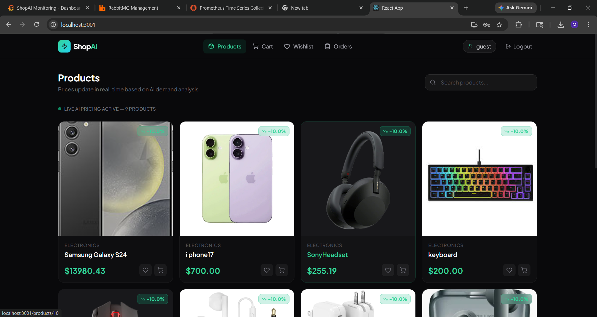
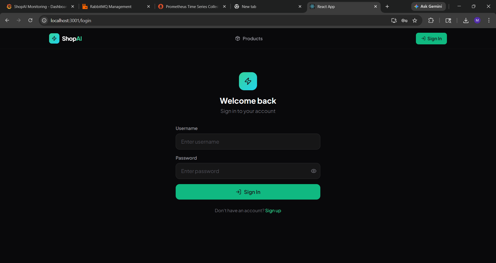
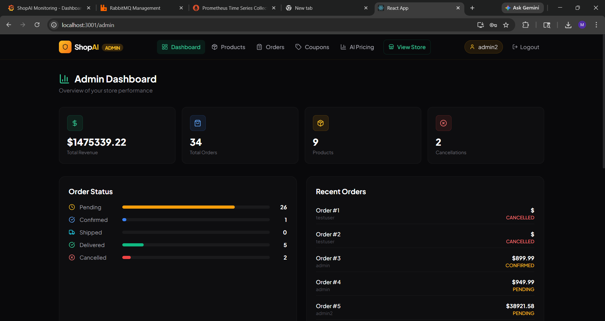
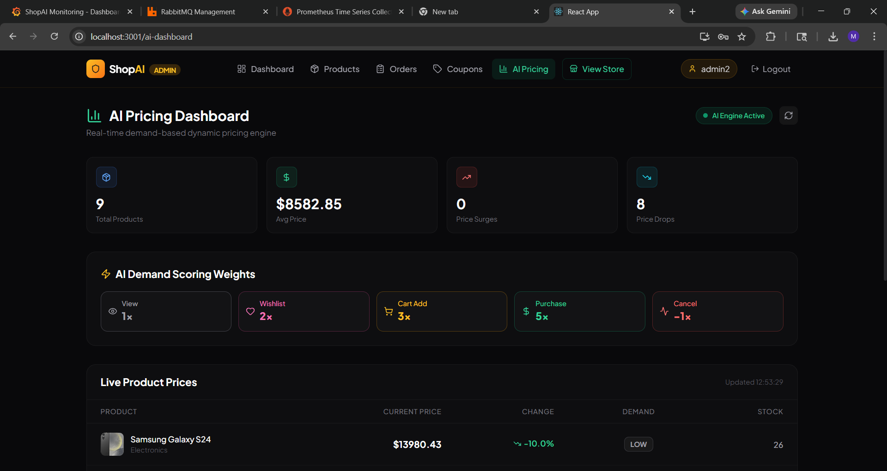
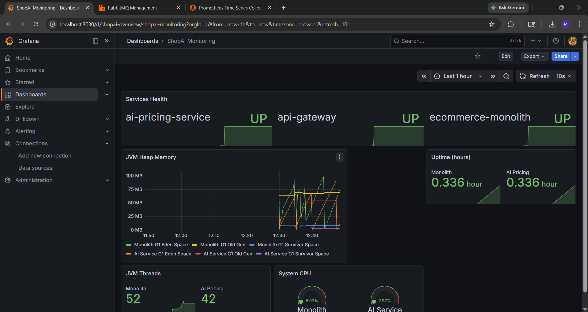
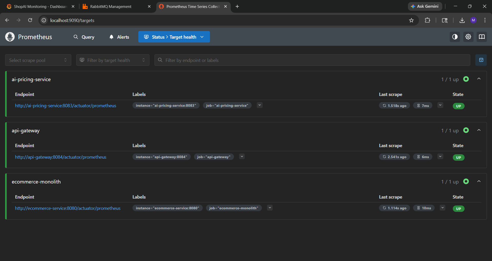
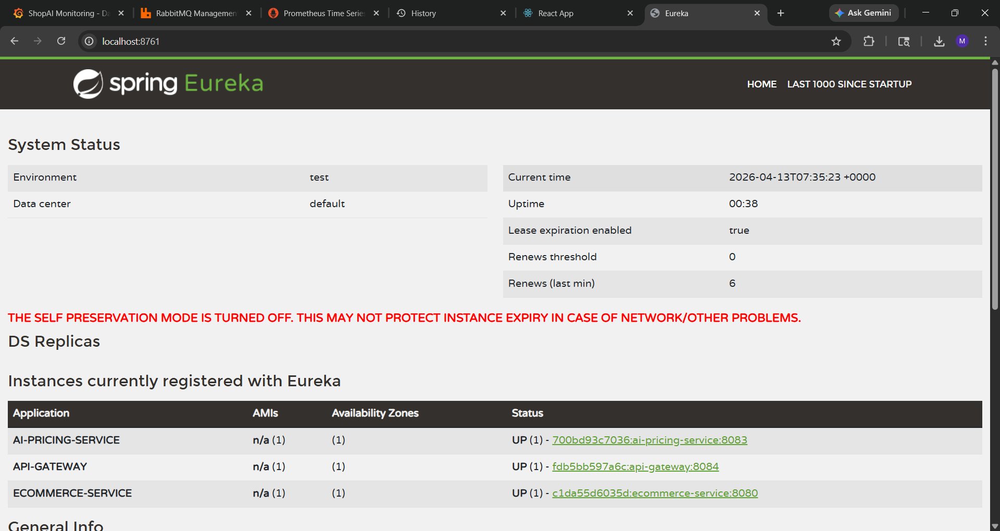
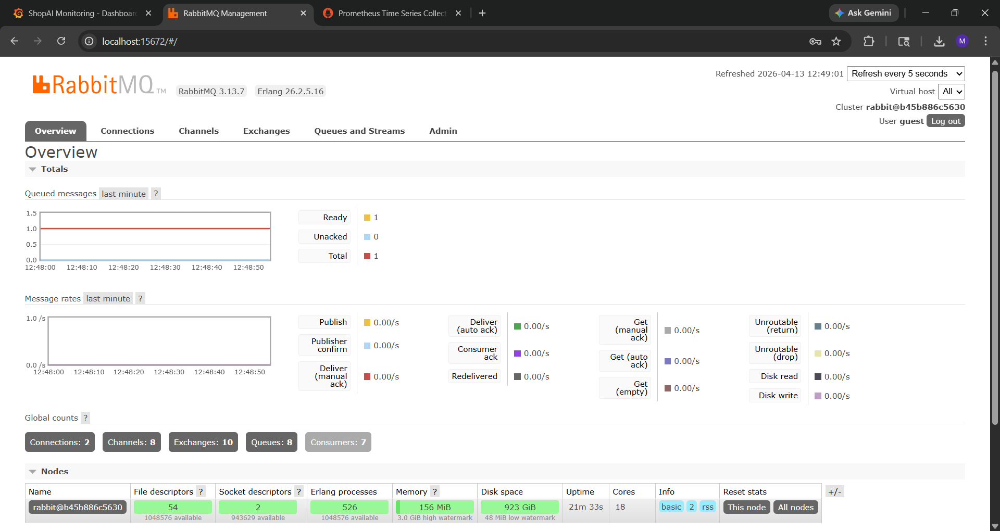
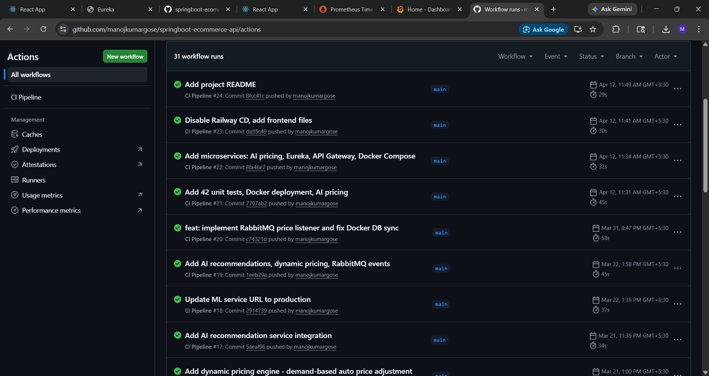

# ⚡ ShopAI — AI-Powered E-Commerce Platform

<p align="center">
  <strong>A Full-Stack E-Commerce Platform Built with Java, Spring Boot, React, Microservices and Intelligent Dynamic Pricing.</strong>
</p>

<p align="center">
  
  
  
  
  
  
</p>

<p align="center">
  <a href="https://github.com/manojkumargose/springboot-ecommerce-api/actions/workflows/ci.yml">
    
  </a>
</p>

---

## 🚀 Overview

**ShopAI** is a full-stack e-commerce platform designed to demonstrate modern backend engineering, distributed systems, and intelligent pricing strategies.

Unlike traditional e-commerce applications, ShopAI integrates a demand-based dynamic pricing engine that adjusts product prices according to stock consumption.

The platform follows a microservices-oriented architecture and incorporates service discovery, API gateway routing, asynchronous messaging, caching, containerization, automated testing, and infrastructure monitoring.

### ⭐ Key Highlights

* Full-stack e-commerce application.
* Demand-based dynamic pricing engine.
* Microservices architecture using Spring Cloud.
* Centralized API Gateway and Eureka Service Discovery.
* Asynchronous communication using RabbitMQ.
* Redis caching.
* JWT-based authentication and authorization.
* Docker Compose deployment with 12 containers.
* Prometheus and Grafana monitoring.
* GitHub Actions CI/CD pipeline.
* 42 automated unit tests.

---

## 📸 Application Screenshots

### 🛍️ Customer Interface

**Product Listing**



**Authentication**



### 🛠️ Admin Dashboard



### 🤖 Dynamic Pricing Analytics



### 📊 Infrastructure Monitoring

**Grafana Dashboard**



**Prometheus Service Targets**



**Eureka Service Discovery**



**RabbitMQ Management**



**GitHub Actions CI/CD**



---

## 🧰 Technology Stack

| Category            | Technologies               |
| ------------------- | -------------------------- |
| Backend             | Java 21, Spring Boot 3.2   |
| Frontend            | React 18, Tailwind CSS     |
| Security            | Spring Security, JWT       |
| ORM                 | Spring Data JPA, Hibernate |
| Database            | MySQL 8.0                  |
| Caching             | Redis                      |
| API Gateway         | Spring Cloud Gateway       |
| Service Discovery   | Netflix Eureka             |
| Messaging           | RabbitMQ                   |
| Monitoring          | Prometheus, Grafana        |
| Distributed Tracing | Zipkin                     |
| Testing             | JUnit 5, Mockito, AssertJ  |
| CI/CD               | GitHub Actions             |
| Containerization    | Docker, Docker Compose     |
| Orchestration       | Kubernetes manifests       |

---

## 🏗️ System Architecture

ShopAI uses a microservices-oriented architecture with centralized API routing and service discovery.

```text
                    ┌──────────────────┐
                    │   React Frontend │
                    │     Port 3001    │
                    └────────┬─────────┘
                             │
                             ▼
                    ┌──────────────────┐
                    │    API Gateway   │
                    │     Port 8084    │
                    └────────┬─────────┘
                             │
                ┌────────────┴────────────┐
                │                         │
                ▼                         ▼
       ┌─────────────────┐       ┌─────────────────┐
       │ Ecommerce       │       │ AI Pricing      │
       │ Application     │       │ Service         │
       │ Port 8080       │       │ Port 8083       │
       └────────┬────────┘       └────────┬────────┘
                │                         │
                ▼                         ▼
       ┌─────────────────┐       ┌─────────────────┐
       │ MySQL           │       │ Pricing MySQL   │
       │ Redis           │       │ Database        │
       └────────┬────────┘       └────────┬────────┘
                │                         │
                └────────────┬────────────┘
                             │
                             ▼
                    ┌──────────────────┐
                    │    RabbitMQ      │
                    │ Message Broker   │
                    └──────────────────┘


       ┌────────────────────────────────────┐
       │          Infrastructure            │
       │                                    │
       │ Eureka │ Prometheus │ Grafana      │
       │ Zipkin │ Docker     │ Kubernetes   │
       └────────────────────────────────────┘
```

### Architecture Components

| Component             | Responsibility                              |
| --------------------- | ------------------------------------------- |
| React Frontend        | Customer and admin interfaces               |
| API Gateway           | Centralized API routing                     |
| Eureka Server         | Service registration and discovery          |
| Ecommerce Application | Product, authentication and cart operations |
| AI Pricing Service    | Demand-based product pricing                |
| MySQL                 | Persistent application data                 |
| Redis                 | Caching                                     |
| RabbitMQ              | Asynchronous messaging                      |
| Prometheus            | Metrics collection                          |
| Grafana               | Monitoring and visualization                |
| Zipkin                | Distributed request tracing                 |

---

## 🤖 Dynamic Pricing Engine

One of ShopAI's key features is its demand-based dynamic pricing engine.

The pricing mechanism adjusts product prices according to the percentage of available stock sold.

### Pricing Formula

```math
Price = BasePrice × (1 + 0.25 × PercentSold)
```

Where:

* `BasePrice` = Original product price.
* `PercentSold` = Proportion of initial stock sold.
* `0.25` = Pricing adjustment coefficient.

### Example

Consider a product with:

* Base Price: ₹1,000
* Initial Stock: 50 units

| Units Sold | Percentage Sold | Dynamic Price |
| ---------- | --------------: | ------------: |
| 10         |             20% |        ₹1,050 |
| 25         |             50% |        ₹1,125 |
| 40         |             80% |        ₹1,200 |

When additional inventory is restocked, the pricing calculation can reflect the updated inventory position.

**Note:** The current pricing mechanism is a rule-based demand pricing algorithm, not a trained machine learning model.

---

## 🔐 Security Features

* JWT-based authentication.
* Spring Security integration.
* Role-based authorization.
* Protected application endpoints.
* Secure password handling.

---

## 🧪 Testing & Quality Assurance

ShopAI includes automated unit testing using JUnit 5, Mockito, and AssertJ.

**Current test suite: 42 unit tests**

| Test Class                | Tests | Coverage                              |
| ------------------------- | ----: | ------------------------------------- |
| ProductServiceTest        |    20 | CRUD, pricing, stock, recommendations |
| CartServiceTest           |     7 | Cart operations and stock validation  |
| ProductTest               |     5 | Entity behavior and demand levels     |
| ProductControllerTest     |     4 | Product API endpoints                 |
| AuthControllerTest        |     4 | Registration and authentication       |
| EventPublisherServiceTest |     2 | RabbitMQ event publishing             |

### Run Tests

```bash
cd ecommerce
./mvnw test
```

---

## ⚙️ CI/CD Pipeline

ShopAI uses GitHub Actions to automate the testing workflow.

### Pipeline Responsibilities

* Automated build execution.
* Maven test execution.
* Unit test validation.
* Build verification on code pushes.

CI/CD configuration:

```text
.github/workflows/ci.yml
```

[View GitHub Actions](https://github.com/manojkumargose/springboot-ecommerce-api/actions)

---

## 🐳 Docker Deployment

The application infrastructure is containerized using Docker Compose.

### Prerequisites

* Java 21
* Docker Desktop
* Git
* Maven (optional when using Maven Wrapper)

### Installation

**1. Clone the repository**

```bash
git clone https://github.com/manojkumargose/springboot-ecommerce-api.git
```

**2. Navigate to the microservices directory**

```bash
cd springboot-ecommerce-api/ecommerce/microservices
```

**3. Start the application**

```bash
docker-compose up -d
```

**4. Check running containers**

```bash
docker ps
```

**5. Stop the application**

```bash
docker-compose down
```

### Application Access

| Service          | Local URL             |
| ---------------- | --------------------- |
| Frontend         | http://localhost:3001 |
| Main Backend     | http://localhost:8080 |
| API Gateway      | http://localhost:8084 |
| Eureka Dashboard | http://localhost:8761 |
| AI Pricing       | http://localhost:8083 |

*Actual availability depends on successful container startup and service configuration.*

---

## 📁 Project Structure

```text
springboot-ecommerce-api/
│
├── .github/
│   └── workflows/
│       └── ci.yml
│
├── ecommerce/
│   ├── src/
│   │   ├── main/
│   │   └── test/
│   ├── pom.xml
│   └── mvnw
│
├── ecommerce-frontend/
│   ├── src/
│   ├── public/
│   └── package.json
│
└── ecommerce/
    └── microservices/
        ├── eureka-server/
        ├── api-gateway/
        ├── ai-pricing-service/
        ├── docker-compose.yml
        └── kubernetes/
```

---

## 🎯 Engineering Concepts Demonstrated

Through ShopAI, the following engineering concepts are demonstrated:

* REST API development.
* Microservices communication.
* Service registration and discovery.
* API Gateway architecture.
* Asynchronous event-driven communication.
* Database integration and ORM.
* Distributed caching.
* Authentication and authorization.
* Containerized application deployment.
* Automated testing and CI/CD.
* Application metrics and monitoring.

---

## 🔮 Future Enhancements

Potential improvements for future development:

* Machine learning-based demand forecasting.
* Price elasticity estimation.
* Personalized product recommendations.
* Advanced inventory prediction.
* Real-time analytics dashboard.
* Kubernetes deployment automation.
* Integration and performance testing.
* Advanced observability and alerting.

---

## 👨‍💻 Author

**Manoj Kumar Gose**

Java Backend Developer | AI/ML Enthusiast | Full-Stack Developer

GitHub: [@manojkumargose](https://github.com/manojkumargose)

---

<p align="center">
  <strong>Built with Java, Spring Boot, React and a passion for engineering.</strong>
</p>
